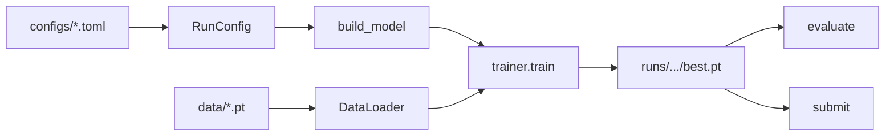

# Codebase Architecture

High-level map of the repository. Use this with [models.md](models.md) and [experiments.md](experiments.md) when navigating the project.

## Design goals

- **One CLI** (`python -m nba_forecasting`) for prepare, train, evaluate, submit, tune, and diagnostics.
- **Config-driven experiments** — TOML under `configs/` inherits from `base.toml`; runtime overrides via `--set path=value`.
- **Registered model families** — each family has a builder, supported loss modes, and optional Ray Tune search profiles.
- **Reproducible splits** — frozen `artifacts/splits/default_split.json` shared across local and cluster runs.
- **Tested pipeline** — pytest covers configs, models, trainer, evaluator, submission, and CLI smoke paths.

## Repository layout

```text
configs/              Experiment defaults (TOML)
src/nba_forecasting/  Installable package
tests/                Unit and integration tests
docs/                 Setup guides, models, experiments, this file
scripts/              Batch runs (model comparison, tune, collect results)
cluster/              Izar Slurm helpers
data/                 Local dataset (gitignored)
runs/                 Training outputs (gitignored)
artifacts/            Frozen splits and CV metadata (gitignored)
```

## Package modules (`src/nba_forecasting/`)

| Module | Role |
| --- | --- |
| `cli.py` | Argument parser and dispatch for all commands |
| `config.py` | TOML loading, typed config dataclasses, overrides |
| `data.py` | Dataset I/O, augmentations, dataloaders, `prepare-data` |
| `metrics.py` | ADE/FDE, softmin and mixture losses |
| `doctor.py` | Environment and optional CUDA/Inductor checks |
| `ray_tune.py` | Hyperparameter search integration |
| `results.py` | Summarize runs, export best configs |
| `model_comparison.py` | Report-table job registry and batch runner |
| `plots.py` | Qualitative trajectory plots |
| `models/` | Model implementations and `MODEL_FAMILIES` registry |
| `runner/` | Training loop, evaluation, submission I/O |

### `models/`

| File | Families |
| --- | --- |
| `builders.py` | `FamilySpec` registry, `build_model`, loss policy |
| `baselines.py` | `baseline`, `joint_gru` |
| `dynamic_graph.py` | `static_graph`, `dynamic_graph_autoregressive`, `dynamic_graph_direct` |
| `graph_transformer.py` | `graph_transformer` (delta and MDN heads) |
| `mart.py` | `mart_hypergraph` (ported baseline; see [models.md](models.md#mart)) |
| `common.py` | Shared forecast types, graph prep, `forecast_model` helper |

### `runner/`

| File | Role |
| --- | --- |
| `trainer.py` | Epoch loop, early stopping, EMA/SWA hooks |
| `recipe.py` | Loss assembly (point, sample-mode, mixture NLL) |
| `evaluator.py` | Val/holdout metrics, TTA, ensembles |
| `submission.py` | Kaggle CSV export |
| `io.py` | Checkpoint load/save, device/autocast helpers |

## Typical data flow



1. **Prepare** (`prepare-data`) consolidates tensors and writes the frozen split.
2. **Train** loads config + data, builds the model family, runs the trainer, writes `history.csv` and `best.pt`.
3. **Evaluate** reloads checkpoint + config, runs metrics on val/holdout (optional xy TTA).
4. **Submit** writes `sample_submission.csv`-shaped predictions.

## Config inheritance

```text
base.toml          Shared task shape, augmentations, default training knobs
  ├── baseline.toml / joint_gru.toml     GRU references (no velocity)
  ├── static_graph.toml … dynamic_graph_direct.toml
  ├── graph_transformer.toml / graph_transformer_mdn.toml
  ├── mart.toml
  └── tune_*.toml                      Ray Tune starting points
```

Override precedence: base → `extends` chain → CLI `--set` / `--epochs` / etc.

## Scripts vs CLI

| Need | Entry point |
| --- | --- |
| Single model, interactive | `python -m nba_forecasting train --config …` |
| Full report table batch | `python -m nba_forecasting model-comparison` |
| Hyperparameter search | `bash scripts/run_tune.sh` or `tune` CLI |
| Aggregate metrics | `python3 scripts/collect_results.py` |
| Quick health check | `python -m nba_forecasting doctor` |
| Demo / CI smoke | `bash scripts/demo.sh` |

## Tests

`tests/` mirrors package structure:

- `test_config.py`, `test_data.py`, `test_metrics.py` — core utilities
- `models/` — forward-pass and builder smoke per family
- `runner/` — trainer, evaluator, submission
- `test_cli.py` — end-to-end CLI on synthetic data

Run: `uv run pytest` (see [setup/local.md](setup/local.md#development-checks)).
